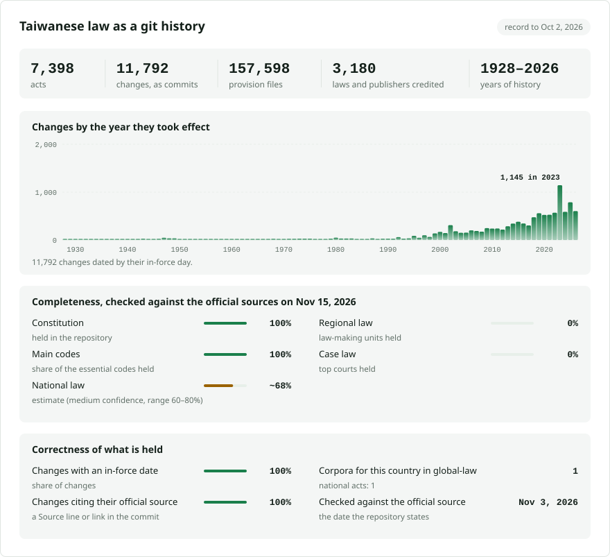

# Taiwan: law history in git

[繁體中文](README.md) · **English**

<picture>
<source media="(prefers-color-scheme: dark)" srcset="data/effort-dark.svg">

</picture>

The law of Taiwan (the Republic of China) as a git history: one file per article, one commit per version on the day it took effect, and the act that made each change as the commit's author. `git blame` names the act behind every paragraph; `git log` lists every change to an article; picking a date gives the text in force that day.

Part of [lexifina/global-law](https://github.com/lexifina/global-law), one git history for every country's law: this is Taiwan's national law, which global-law reads at `taiwan/national/acts/`.

**What is in it now:** 7,398 acts: the Constitution, its Additional Articles and 5 other texts filed with them, 1,005 laws (法律) and 6,386 regulations (命令). 505 of the laws have every version the Legislative Yuan's 立法院法律系統 shows, 3,892 versions back to 1928; every other act has one text, its current text from the Ministry of Justice's 全國法規資料庫. [`ACTS.md`](ACTS.md) lists the acts taken from 全國法規資料庫, under their folder names before the layout move; [`data/paths.json`](data/paths.json) maps each of those names to its folder.

Each act is in `<kind>/<year>/<code>/` (`constitution`, `law` or `regulation`; the year of its first promulgation or issue; the database's code, or `ly<number>` for a law only the Legislative Yuan lists), with one file per article in `article/` and `structure.md` for the order and headings (`law/1984/N0030001/` is the 勞動基準法, the Labor Standards Act; the Constitution is [`constitution/1947/A0000001/`](constitution/1947/A0000001/)).

The text is in Chinese (traditional characters), as the two official publishers print it. An English translation is not part of this record.

## Questions as git commands

| Question | Command |
| --- | --- |
| Every change to Article 38 of the Labor Standards Act | `git log --follow -p --word-diff -- law/1984/N0030001/article/38.md` |
| Which act wrote each line of Article 38? | `git blame law/1984/N0030001/article/38.md` |
| Every version of the Labor Standards Act, with the day each took effect | `git log --grep="^Kind: version" --format="%h %(trailers:key=In-force,valueonly,separator=) %an" -- law/1984/N0030001 labor-standards-act` |
| Article 38 as in force on 1 January 2010 | `python tools/on_date.py 2010-01-01 law/1984/N0030001 38` |

Folders had other names before the layout move of 10 November 2026; `--follow`, `git blame` and `tools/on_date.py` follow them, and a whole act's log names both (`labor-standards-act` is the earlier name).

**Outside git**, we also host this record publicly, for free:

- **[Ask Claude about Taiwanese law](https://global-law.lexifina.com/v1/try_claude?country=taiwan)**: opens Claude with a first question ready.
- **[Ask ChatGPT](https://global-law.lexifina.com/v1/try_chatgpt?country=taiwan)**: the same question in ChatGPT.
- **[Search Taiwanese law on our site](https://lexifina.com/law?country=taiwan&q=%E7%89%B9%E5%88%A5%E4%BC%91%E5%81%87)**: a search for "特別休假" (annual leave), with each provision's text and its versions, no account needed.
- **[Developer REST API](https://global-law.lexifina.com/v1/search_law?query=%E7%89%B9%E5%88%A5%E4%BC%91%E5%81%87&jurisdiction=taiwan)**: the same search as JSON, with no key. See the [documentation here](https://lexifina.com/api/global-law).

Both assistants read the record through the free Global law connector (MCP, `https://global-law.lexifina.com/mcp`); the first time, the chat gives you the link that adds it. Ask in Chinese or in English.

**Host it yourself easily.** All it takes is git and Python, and the tools run on your machine:

```sh
git clone --depth 1 https://github.com/lexifina/global-law && cd global-law
python3 tools/countries.py add taiwan/national/acts
python3 tools/law.py show 2026-01-01 taiwan/national/acts/law/1984/N0030001/article/38.md
```

Opened in Claude Code, Cursor, VS Code or Codex, the clone also starts a local MCP server with the same tools ([MCP.md](https://github.com/lexifina/global-law/blob/main/MCP.md)).

## Dates

Each law commit's author date is noon, Asia/Taipei, on the day the version took effect, and the commit carries that day in its `In-force:` trailer, with `In-force-basis:` saying where it comes from:

- for a version from 立法院法律系統, the commencement day (施行) the record states; where it states none, the third day counted from promulgation (中央法規標準法 §13). Articles an amendment leaves to commence later are carried from the version's own day, and the commit message quotes the record's dates;
- for a current text from 全國法規資料庫, which gives no commencement day, the third day counted from the page's 修正日期 or 公布日期; the first five laws (the Constitution, its Additional Articles, the Criminal Code and the codes of civil and criminal procedure) are dated by that page date itself, so the Constitution's day is its promulgation, 1 January 1947, not 25 December 1947, when it took effect;
- past versions were appended after the earlier history, so commit dates are the day of appending, and git cannot store dates before 1970 (611 commits carry 1970-01-01 as author date, with the real day in `In-force:`). Ask for a date with `tools/on_date.py`, not `git log --before`.

A version from 立法院法律系統 is credited to the act that made it, as the record names it (`勞動基準法修正 (2016-12-21)`: the law, the action and its promulgation day), at an address that cannot exist. A current text from 全國法規資料庫 is credited to the publisher, `全國法規資料庫 (law.moj.gov.tw)`, as the page does not name the amending act; the first five laws are credited to the law itself (`中華民國刑法 (C0000001)`).

## How it is checked

- Every act from 全國法規資料庫 was parsed from its page, and its letters and digits had to equal those an independent extractor reads from the page; for the first five laws `builder/check_repo.py` also compares every file byte for byte, with the results in [`REPRODUCE.md`](REPRODUCE.md).
- Before each block of past versions was pushed, every version was read back from git on the day it took effect and compared with the text read from 立法院法律系統, with every commit's trailers parsed.
- Where a law has both sources, its block of past versions ends with a `publisher-text` commit that puts back the published 全國法規資料庫 files and counts the articles the two publishers print differently (mostly punctuation).
- History is append-only: older versions found later are appended at the end, and no published commit is rewritten.
- [vulnerabilities/](vulnerabilities/README.en.md): possible drafting mistakes in this law, found by global-law's detectors and checked by hand. Not run yet.

## What it does not show

- **Past versions of most acts.** 6,893 acts have one text: the constitutional texts, every regulation (立法院法律系統 holds laws only) and the other laws, whose past versions have not been added yet.
- **Repealed acts.** Acts either source lists as repealed (廢止) were left out.
- **The Civil Code from 全國法規資料庫.** Its page holds articles not yet in force, so it was left out; the Code is here as the five books 立法院法律系統 lists (`law/1929/ly04507/` 總則 to `law/1930/ly04515/` 繼承), dated by the rules above, so the amendment of art. 1223 promulgated on 17 August 2026, which takes effect six months later, shows from 19 August 2026.
- **Attachments**, such as the table of Criminal Code art. 185-3, are not copied; `structure.md` marks them `(本條文有附件)`.
- **Local regulations, constitutional interpretations and judgments, and other case law** are not part of this record.

## Sources

| Source | Kind | Past versions | Notes |
| --- | --- | --- | --- |
| [全國法規資料庫](https://law.moj.gov.tw) (Ministry of Justice) | Official database of laws and regulations | no: the current text only (its history pages are closed to automated access by robots.txt) | The current text of every act here; Open Government Data License, version 1.0 |
| [立法院法律系統](https://lis.ly.gov.tw) (Legislative Yuan) | The Legislative Yuan's record of laws and their amendments | yes, every version it shows | The text, passing, promulgation and commencement of each version, named in each commit's `Source:` trailer |

## Licence

See [`LICENSE`](LICENSE). Constitutions, laws and orders are not the subject of copyright in Taiwan (著作權法第9條); the database's pages are used under the Open Government Data License, version 1.0, and the Legislative Yuan's material under its open data declaration, both with attribution:

資料來源：法務部「全國法規資料庫」(https://law.moj.gov.tw/)，依「政府資料開放授權條款－第1版」提供。資料來源：立法院法律系統 (https://lis.ly.gov.tw/)。

No AI model wrote or changed legal text, and none runs when the history is built; an AI model wrote the builder, the checks and the documentation (see [`REPRODUCE.md`](REPRODUCE.md)).

## Visualisations

- [visualisations/](visualisations/README.en.md): charts drawn from this repository. Not drawn yet.

## More

From [lexifina/global-law](https://github.com/lexifina/global-law):

- [FEATURES.md](https://github.com/lexifina/global-law/blob/main/FEATURES.md): every feature, and what every corpus must support (`git blame`, `law.py`, the MCP tools)
- [FAQ.md](https://github.com/lexifina/global-law/blob/main/FAQ.md): questions and answers · [CONTRIBUTING.md](https://github.com/lexifina/global-law/blob/main/CONTRIBUTING.md): proposing changes · [MCP.md](https://github.com/lexifina/global-law/blob/main/MCP.md): the MCP server · [REPRODUCE.md](https://github.com/lexifina/global-law/blob/main/REPRODUCE.md): how it was built · [CHANGELOG.md](https://github.com/lexifina/global-law/blob/main/CHANGELOG.md)
- [FRESHNESS.md](https://github.com/lexifina/global-law/blob/main/FRESHNESS.md): how current each corpus is · [Monitoring](https://github.com/lexifina/global-law/tree/main/monitoring): whether updates are running · [WATCHING.md](https://github.com/lexifina/global-law/blob/main/WATCHING.md): how each official source is watched for changes
- [performance/](https://github.com/lexifina/global-law/tree/main/performance): how fast the tools are, measured
- [visualisations/](https://github.com/lexifina/global-law/tree/main/visualisations): charts and bridges across the world's law
- [Vulnerabilities](https://github.com/lexifina/global-law/tree/main/vulnerabilities): mistakes in legislation as published
