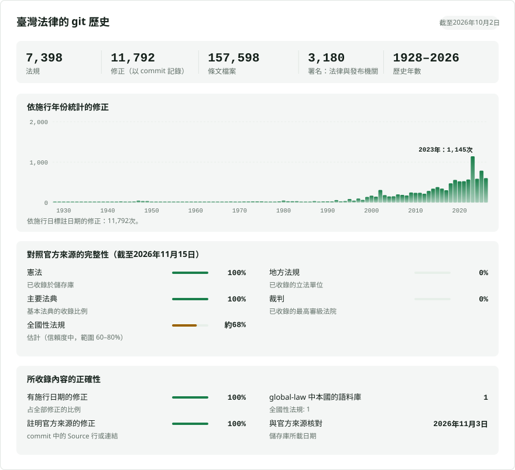

# 臺灣：git 中的法律沿革

**繁體中文** · [English](README.en.md)

<picture>
<source media="(prefers-color-scheme: dark)" srcset="data/zh-Hant/effort-dark.svg">

</picture>

以 git 歷史呈現的臺灣（中華民國）法律：每一條為一個檔案，每一個版本為一次提交（commit），日期為該版本施行之日，並以作成各項修正的法規為提交的作者（author）。`git blame` 顯示每一項背後的法規；`git log` 列出一條的所有修正；選定一個日期，即可取得當日施行的條文。

本儲存庫是 [lexifina/global-law](https://github.com/lexifina/global-law)（將各國法律彙整為單一 git 歷史）的一部分：這裡是臺灣的中央法規，global-law 於 `taiwan/national/acts/` 讀取。

**目前收錄內容：** 7,398 部法規：憲法、憲法增修條文及另外 5 件與其一併收錄的文本、1,005 部法律及 6,386 部命令。其中 505 部法律收有立法院法律系統所顯示的每一個版本，共 3,892 個版本，最早可溯至 1928 年；其餘每部法規只有一個文本，即法務部全國法規資料庫的現行條文。[`ACTS.md`](ACTS.md) 以版面調整前的資料夾名稱列出取自全國法規資料庫的法規；[`data/paths.json`](data/paths.json) 列出各該名稱所對應的資料夾。

每部法規位於 `<kind>/<year>/<code>/`（`constitution`、`law` 或 `regulation`；首次公布或發布的年份；資料庫的代碼，或僅列於立法院之法律則為 `ly<number>`），每一條為 `article/` 中的一個檔案，`structure.md` 記載條文順序及編章節標題（`law/1984/N0030001/` 為勞動基準法；憲法為 [`constitution/1947/A0000001/`](constitution/1947/A0000001/)）。

條文為中文（正體字），與兩個官方發布機關所刊載者相同。本紀錄不包含英文譯本。

## 以 git 指令回答的問題

| 問題 | 指令 |
| --- | --- |
| 勞動基準法第38條的所有修正 | `git log --follow -p --word-diff -- law/1984/N0030001/article/38.md` |
| 第38條的每一行是由哪一部法規寫入？ | `git blame law/1984/N0030001/article/38.md` |
| 勞動基準法的每一個版本及各版本的施行日 | `git log --grep="^Kind: version" --format="%h %(trailers:key=In-force,valueonly,separator=) %an" -- law/1984/N0030001 labor-standards-act` |
| 2010年1月1日施行的第38條 | `python tools/on_date.py 2010-01-01 law/1984/N0030001 38` |

2026年11月10日版面調整前，資料夾另有其他名稱；`--follow`、`git blame` 及 `tools/on_date.py` 均會追溯舊名稱，整部法規的紀錄也會同時列出新舊名稱（`labor-standards-act` 為舊名稱）。

**在 git 之外**，我們也免費公開提供這份紀錄：

- **[向 Claude 詢問臺灣法律](https://global-law.lexifina.com/v1/try_claude?country=taiwan)**：開啟 Claude，並已備妥第一個問題。
- **[詢問 ChatGPT](https://global-law.lexifina.com/v1/try_chatgpt?country=taiwan)**：在 ChatGPT 中提出同一問題。
- **[在本網站檢索臺灣法律](https://lexifina.com/law?country=taiwan&q=%E7%89%B9%E5%88%A5%E4%BC%91%E5%81%87)**：檢索「特別休假」，顯示每一條文的內容及其各個版本，無須帳號。
- **[開發者 REST API](https://global-law.lexifina.com/v1/search_law?query=%E7%89%B9%E5%88%A5%E4%BC%91%E5%81%87&jurisdiction=taiwan)**：以 JSON 傳回同一檢索結果，無須金鑰。請參閱[此處的說明文件](https://lexifina.com/api/global-law)。

兩個助理都透過免費的 Global law 連接器（MCP，`https://global-law.lexifina.com/mcp`）讀取這份紀錄；第一次使用時，對話中會提供新增該連接器的連結。可以用中文或英文提問。

**輕鬆自行架設。** 只需要 git 和 Python，工具在您自己的電腦上執行：

```sh
git clone --depth 1 https://github.com/lexifina/global-law && cd global-law
python3 tools/countries.py add taiwan/national/acts
python3 tools/law.py show 2026-01-01 taiwan/national/acts/law/1984/N0030001/article/38.md
```

在 Claude Code、Cursor、VS Code 或 Codex 中開啟時，這份複製（clone）也會啟動一個提供相同工具的本機 MCP 伺服器（[MCP.md](https://github.com/lexifina/global-law/blob/main/MCP.md)）。

## 日期

每個法律提交的作者日期（author date）為該版本施行之日的中午（Asia/Taipei），提交並將該日記載於 `In-force:` 尾註（trailer），另以 `In-force-basis:` 說明其依據：

- 取自立法院法律系統的版本，採該紀錄所載的施行日；未記載者，採自公布之日起算至第三日（中央法規標準法第13條）。修正條文中另定較晚施行的條文，自該版本本身的日期起即予納入，提交訊息並引述該紀錄所載的日期；
- 取自全國法規資料庫的現行條文，因資料庫未提供施行日，採自該頁面的修正日期或公布日期起算至第三日；最初五部法律（憲法、憲法增修條文、中華民國刑法、民事訴訟法及刑事訴訟法）則以該頁面日期本身為準，因此憲法的日期為其公布日 1947年1月1日，而非其施行日 1947年12月25日；
- 過去的版本是附加在較早的歷史之後，因此提交日期為附加之日；且 git 無法儲存 1970 年以前的日期（611 個提交的作者日期為 1970-01-01，實際日期記載於 `In-force:`）。查詢特定日期請使用 `tools/on_date.py`，而非 `git log --before`。

取自立法院法律系統的版本，以作成該版本的法案為作者，名稱依該紀錄所載（`勞動基準法修正 (2016-12-21)`：法律、異動類別及其公布日），並使用一個不可能存在的位址。取自全國法規資料庫的現行條文，因頁面未載明修正的法案，以發布者 `全國法規資料庫 (law.moj.gov.tw)` 為作者；最初五部法律則以該法律本身為作者（`中華民國刑法 (C0000001)`）。

## 查核方式

- 取自全國法規資料庫的每部法規均由其頁面解析而得，其文字及數字須與另一獨立擷取程式自該頁面讀取者相同；最初五部法律並由 `builder/check_repo.py` 逐位元組比對每一個檔案，結果載於 [`REPRODUCE.md`](REPRODUCE.md)。
- 每一批過去的版本在推送前，都依各版本施行之日自 git 讀回，並與自立法院法律系統讀取的條文比對，同時解析每個提交的尾註。
- 同時有兩個來源的法律，其過去版本的批次以一個 `publisher-text` 提交結束；該提交放回全國法規資料庫所刊載的檔案，並計算兩個發布機關刊載不同的條文數（多為標點符號）。
- 歷史僅予附加：事後發現的較舊版本附加於最後，已發布的提交不會被改寫。
- [vulnerabilities/](vulnerabilities/): 本法律中可能的起草錯誤，由 global-law 的偵測器發現並經人工核對。尚未執行。

## 未呈現的內容

- **大多數法規的過去版本。** 6,893 部法規只有一個文本：憲法性文本、所有命令（立法院法律系統僅收錄法律），以及其他尚未加入過去版本的法律。
- **已廢止的法規。** 任一來源列為廢止的法規均未收錄。
- **取自全國法規資料庫的民法。** 其頁面含有尚未施行的條文，因此未予採用；民法係依立法院法律系統所列的五編收錄（`law/1929/ly04507/` 總則至 `law/1930/ly04515/` 繼承），並依上述規則定其日期，因此 2026年8月17日公布、於六個月後施行的第1223條修正，自 2026年8月19日起即予呈現。
- **附件**，例如中華民國刑法第185條之3的附表，並未複製；`structure.md` 以 `(本條文有附件)` 標示。
- **地方法規、大法官解釋及憲法法庭判決，以及其他裁判**，均不在本紀錄範圍內。

## 來源

| 來源 | 類型 | 過去版本 | 備註 |
| --- | --- | --- | --- |
| [全國法規資料庫](https://law.moj.gov.tw)（法務部） | 官方法規資料庫 | 無：僅有現行條文（其沿革頁面依 robots.txt 不開放自動存取） | 本儲存庫每部法規的現行條文；政府資料開放授權條款第1版 |
| [立法院法律系統](https://lis.ly.gov.tw)（立法院） | 立法院的法律及其修正紀錄 | 有，收錄其顯示的每一個版本 | 每一版本的條文、通過、公布及施行，於每個提交的 `Source:` 尾註中載明 |

## 授權

請參閱 [`LICENSE`](LICENSE)。在臺灣，憲法、法律及命令不得為著作權之標的（著作權法第9條）；資料庫的頁面依政府資料開放授權條款第1版使用，立法院的資料則依其開放資料宣告使用，兩者均須標示出處：

資料來源：法務部「全國法規資料庫」(https://law.moj.gov.tw/)，依「政府資料開放授權條款－第1版」提供。資料來源：立法院法律系統 (https://lis.ly.gov.tw/)。

沒有任何 AI 模型撰寫或變更法律條文，建置歷史時也不執行任何 AI 模型；建置程式、查核程式及說明文件係由 AI 模型撰寫（參閱 [`REPRODUCE.md`](REPRODUCE.md)）。

本文為英文版（[README.en.md](README.en.md)）的譯文；如有不一致，以英文版為準。

## 視覺化

- [visualisations/](visualisations/): 根據本儲存庫繪製的圖表。尚未繪製。

## 更多資訊

來自 [lexifina/global-law](https://github.com/lexifina/global-law) 儲存庫（英文頁面）：

- [FEATURES.md](https://github.com/lexifina/global-law/blob/main/FEATURES.md): 全部功能，以及每個語料庫須支援的內容（`git blame`、`law.py`、MCP 工具）
- [FAQ.md](https://github.com/lexifina/global-law/blob/main/FAQ.md): 常見問題 · [CONTRIBUTING.md](https://github.com/lexifina/global-law/blob/main/CONTRIBUTING.md): 提出修改建議 · [MCP.md](https://github.com/lexifina/global-law/blob/main/MCP.md): MCP 伺服器 · [REPRODUCE.md](https://github.com/lexifina/global-law/blob/main/REPRODUCE.md): 建置方法 · [CHANGELOG.md](https://github.com/lexifina/global-law/blob/main/CHANGELOG.md)
- [FRESHNESS.md](https://github.com/lexifina/global-law/blob/main/FRESHNESS.md): 各語料庫的更新程度 · [監測](https://github.com/lexifina/global-law/tree/main/monitoring): 更新是否正常運作 · [WATCHING.md](https://github.com/lexifina/global-law/blob/main/WATCHING.md): 如何監看每個官方來源的變動
- [performance/](https://github.com/lexifina/global-law/tree/main/performance): 工具速度的實測結果
- [visualisations/](https://github.com/lexifina/global-law/tree/main/visualisations): 貫穿全球法律的圖表與關聯
- [漏洞](https://github.com/lexifina/global-law/tree/main/vulnerabilities): 已公布法律文本中的錯誤
